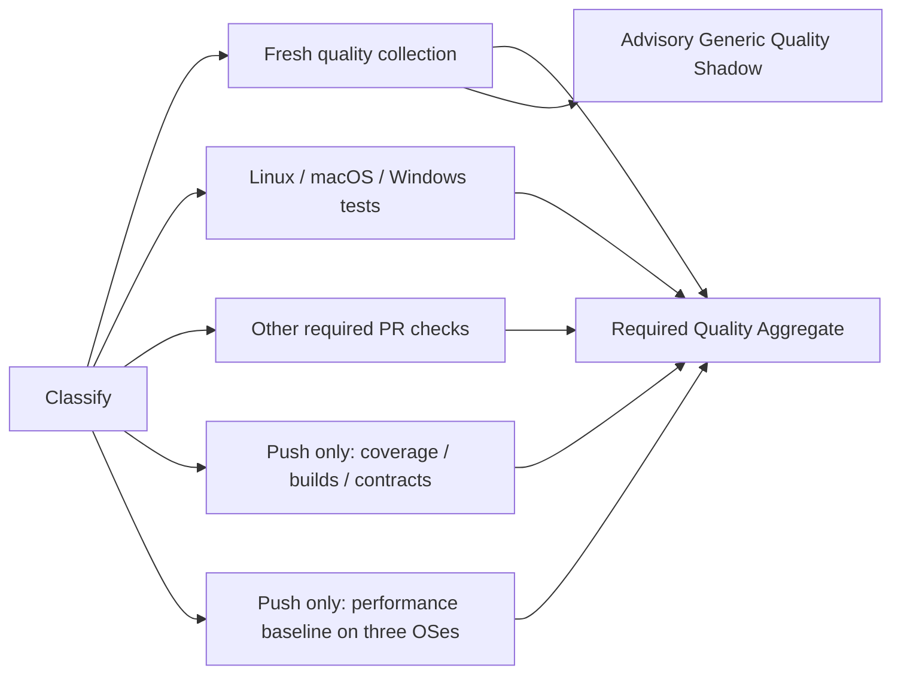

# CI collection diagnosis (#61)

The baseline is commit `4620e211d11d15644eaaa2030ce99d7aed118190`.
Engineering Policy semantics are unchanged: required jobs/platforms, coverage and
CRAP thresholds, measurement definitions, fresh commit-bound evidence, debt and
failure aggregation remain authoritative. No old coverage is reused.

## Retained hosted observations

These five successful runs are **not five matched A/B samples**. They have
separate source/merge identities and uncontrolled runner scheduling. The three
PR runs and two push runs must not be combined into one performance distribution.

| Run | Event | Required aggregate complete (s) | API lifecycle (s) | Total runner wall minutes | Quality job (s) |
| --- | --- | ---: | ---: | ---: | ---: |
| [#73](https://github.com/musutrade/GateHouse/actions/runs/38678822897) | PR | 791 | 843 | 38.72 | 768 |
| [#76](https://github.com/musutrade/GateHouse/actions/runs/38682199206) | PR | 1126 | 1181 | 46.27 | 1076 |
| [#78](https://github.com/musutrade/GateHouse/actions/runs/38684527328) | PR | 1165 | 1267 | 48.17 | 1142 |
| [#77](https://github.com/musutrade/GateHouse/actions/runs/38684124984) | push | 2441 | 2442 | 164.45 | 1075 |
| [#79](https://github.com/musutrade/GateHouse/actions/runs/38686497177) | push | 3468 | 3469 | 171.82 | 1016 |

The aggregate latency starts at run creation; runner work sums overlapping job
wall times with no OS billing multiplier. API lifecycle includes advisory work
and API completion lag. In #78, the quality job takes 19:02, the required
aggregate completes at 19:25, and the API lifecycle is 21:07. Generic Quality
Shadow is advisory and does not extend the required path.



For all three observed PRs, quality collection is the last required child.
For both pushes it is **Quality Performance Baseline (macos-latest)**, taking
2414 and 2591 seconds. In #79 that job starts 868 seconds after run creation;
this is dispatch/dependency waiting, not benchmark execution: classify itself
starts at 854s, runs for 6s, then macOS starts 8s later. Timestamps alone do not
identify GitHub's queue cause. Shortening Linux quality does not shorten these
observed push critical paths.

The retained [#79 macOS benchmark report](push-macos-benchmark.json), from
[artifact 11952326339](https://github.com/musutrade/GateHouse/actions/runs/38686497177/artifacts/11952326339),
attributes 446.43s to the cold test run and 1893.21s to five warm test runs
(371.90–389.60s each, median 374.85s): about 90% of the 2591s job wall time.
Those repetitions are the existing benchmark sampling contract, not an
accidental duplicate to remove. This reinforces the shared test-cost follow-up
in #55; the current change preserves all five benchmark samples.

## Collection stages and nested commands

| Run | Legacy (s) | Production (s) | Risk (s) | Matrix (s) |
| --- | ---: | ---: | ---: | ---: |
| #73 | 299.79 | 1.62 | 373.73 | 69.69 |
| #76 | 399.83 | 3.00 | 555.49 | 89.87 |
| #78 | 433.60 | 3.03 | 565.37 | 95.32 |
| #77 | 396.02 | 2.95 | 555.93 | 87.89 |
| #79 | 395.02 | 2.32 | 514.22 | 75.46 |

[Collection baseline](collection-baseline.json) retains stage values, nested
command timings, original log/API hashes and external raw-log locations. Do not
add command times to their enclosing stages. [PR input](pull_request-input.json)
and [push input](push-input.json) retain attempt identities and job/step timestamps;
[PR timing](pull_request-timing.json) and [push timing](push-timing.json) separate
setup, tool installation, collection, artifact transfer, cleanup and runner work.

The downloadable #78 quality artifact provides the deeper breakdown:

- Legacy compilation: 86 seconds. Library tests: 101.99 seconds; binary unit
  tests: 53.51 seconds. Integration binaries run sequentially, including
  `quality_cli_test` 48.55s, `rename_scope_test` 61.18s, `verify_plan_test` 30.48s.
- Risk base coverage command: 273.37 seconds (55.61s build, 215.06s nextest).
  Head: 241.02 seconds (22.34s build, 215.91s nextest). Both pass 574 tests,
  none skipped. Source measurement adds 14.39s and 14.77s respectively;
  CRAP arithmetic is not an established six-minute bottleneck.
- The slow differential/reference cases take roughly 55–118 seconds each.
  These execution logs are also the baseline for #55; no tests are ignored or
  removed here.
- Production evaluates existing legacy JSON/LCOV; it does **not** rerun tests.
- Matrix already builds once (about 61s), executes two test workers (about 12s),
  then exports each row serially with isolated profiles. Its evaluation and
  export overhead do not justify claiming twelve redundant builds.

Compiled target caching remains disabled, as justified in the earlier
[cache experiment](../ci-topology/closure.md). Download caches and pinned
prebuilt tool installation already exist. Step totals show setup/artifact
costs are much smaller than test execution; they are nested job costs, not
additional critical-path savings. In #78, regression-data and Cargo-source
cache action restore/post work totals 6.679s (4.015 + 2.297 + 0.149 + 0.218);
compiled-state restoration is explicitly skipped. The other four quality-job
cache totals are 1.691–5.294s. These nested action durations and cache keys are
retained in the collection baseline. No cache or bytecode speedup is assumed.

## Reproduction

```sh
python3 tools/quality/ci_timing.py \
  --input docs/quality/issue-61/pull_request-input.json --output /tmp/pr-timing.json
python3 tools/quality/ci_timing.py \
  --input docs/quality/issue-61/push-input.json --output /tmp/push-timing.json
python3 -m unittest discover -s tools/quality/tests -p test_ci_timing.py
```

The timing normalizer now accepts successful completed push runs using the
push-specific required inventory. It rejects failed/skipped/missing required
push jobs, mixed attempts, and combined PR/push cohorts. Existing historical PR
normalization reproduces byte-for-byte as parsed JSON.

## Runner experiment and acceptance

Legacy previously scheduled integration binaries through libtest; risk already
used nextest. The accepted local candidate exposes `coverage.py --test-runner nextest`, keeping
standalone `cargo` as the default. It selects the default nextest profile with
zero retries and no fail-fast, and records the actual measurement command.
The package boundary, locked dependencies, all tests, JSON/LCOV/Cobertura
exports, thresholds and production evaluation stay unchanged. Neither existing
legacy llvm-cov invocation nor nextest collects doctests by default.

The CI collector now explicitly selects nextest. Two alternating pairs on the
same Linux host (8 logical CPUs, Rust/tool versions retained) produced:

| Backend | Samples (s) | Median (s) | Total command wall minutes |
| --- | --- | ---: | ---: |
| cargo/libtest | 473.76, 465.31 | 469.53 | 15.65 |
| nextest | 241.28, 211.81 | 226.54 | 7.55 |

The local median reduction is **51.75% for this collection command**, not the
whole CI. This is **two samples per backend, fewer than five**. Order was
nextest/cargo/cargo/nextest; one initial cold libtest run was excluded from timing.
Dependency compilation state was warm/shared; each invocation generated fresh
profiles and exports, including package rebuilding. Concurrent host activity was
uncontrolled. These samples support retaining the bounded scheduling change,
not a statistically established hosted speedup or billed CPU-cost estimate.

[Timing/command/tool/input records](local-runner-results.json) bind all raw
exports and the durable external ZIP by SHA-256. The four compressed command
logs are retained alongside this report. [Parity evidence](local-runner-parity.json)
retains all 574 test identities, verifies 109 file identities and records **all** raw coverage
differences, not just aggregate percentages. Both nextest runs match the initial
libtest warm-up's coverage summaries and covered segments exactly. Both measured
libtest repetitions omit the test-only polling loop at
`src/verify/report.rs:2933–2938`; one additionally covers the concurrent mkdir
`AlreadyExists` condition at `src/process/replay.rs:185`. Those old-runner
variations are preserved, not normalized away or represented as byte equality.
All four runs pass legacy and production gates; production line coverage ranges
from 17112/18657 (91.7189%) to 17113/18657 (91.7243%), and region coverage from
27262/30709 to 27263/30709. No test, assertion, file, source denominator or
threshold changes. Independent risk collection remains unchanged.

Effective nextest profile selection was also checked: Cargo's workspace root is
`tools/harness-gate`, and its default `.config/nextest.toml` is absent. The
repository-root `.config/nextest.toml` is **not automatically loaded** by these
commands. `--profile default` selects nextest's built-in default; zero retries
and no fail-fast are explicit command arguments. This change does not silently
activate the root file's timeout or CI retry policy. The log records the actual
selected profile. Moving/configuring that file is a separate behavior change.

Hosted acceptance is the implementation PR's required checks, linked from
[#61](https://github.com/musutrade/GateHouse/issues/61), not the local benchmark.
The closure record there reports the actual run and limits; CI must pass before
merge. Rollback is removing the collector's `--test-runner nextest` argument,
returning to libtest without a policy/baseline reset. This does not alter risk's
independent base/head collection or the push benchmarks.
